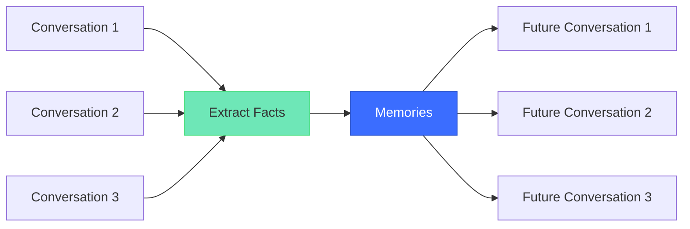

# Conversation vs Memory

Understanding the difference between conversations and memories is crucial to how Memvault works.

## What is a Conversation?

A **conversation** (also called a **session**) is a single interaction thread between you and an AI agent. It includes:

- All messages exchanged (user prompts + assistant responses)
- Timestamps for each message
- Platform metadata (Codex, Claude Code, OpenCode)
- Attachments (if any)

**Key characteristics**:
- Ephemeral by default in most AI platforms
- Linear message sequence
- Complete context for that specific interaction

### Example Conversation

```
You: "Help me write a README for my project"
Assistant: "I'd be happy to help. What does your project do?"
You: "It's a local-first memory system for AI agents"
Assistant: "Great! Here's a draft README structure..."
```

This entire exchange is **one conversation**.

---

## What is Memory?

**Memory** is persistent knowledge extracted from conversations and stored for future use. Memories are:

- Facts about you (preferences, background, expertise)
- Decisions made in past conversations
- Summaries of long discussions
- Knowledge learned over time

**Key characteristics**:
- Persistent across sessions
- Structured with evidence (source tracing)
- Actively maintained and updated
- Injected into future conversations

### Memory Types in Memvault

| Type | Purpose | Example |
|------|---------|---------|
| **Background** | Who you are | "User is a Go developer with 5 years experience" |
| **Preference** | How you work | "Prefers table-driven tests in Go" |
| **Knowledge** | Domain facts | "Project uses SQLite FTS5 for full-text search" |
| **Summary** | Conversation recap | "Discussed README structure and E-E-A-T principles" |

---

## The Relationship



**Conversations** are the raw material. **Memories** are the refined, persistent knowledge.

---

## Why This Matters

### Without Memory

Every conversation starts from zero:

```
Day 1: "I prefer functional programming"
Day 2: "What's your coding style?" (agent forgot)
Day 3: "Do you like OOP or FP?" (agent still doesn't know)
```

### With Memory

The agent remembers:

```
Day 1: "I prefer functional programming" 
       → Memory: "User prefers functional programming style"
Day 2: Agent already knows your preference
Day 3: Agent suggests FP patterns automatically
```

---

## Industry Terminology

Different frameworks use different terms:

| Framework | Short-Term | Long-Term |
|-----------|------------|-----------|
| **Memvault** | Conversation | Memory |
| **LangChain** | Session Memory | Long-Term Memory |
| **Mem0** | Context Window | Persistent Memory |
| **Zep** | Chat History | User Facts |

The concept is the same: **ephemeral context** vs **persistent knowledge**.

---

## How Memvault Handles Both

### Conversation Archiving

Every message is stored as-is:

- Full message text
- Timestamps
- Platform source
- Original snapshots (checksummed)

**Purpose**: Complete audit trail, searchable history.

### Memory Extraction

Agents automatically extract meaningful facts:

- Evidence-backed (links to source messages)
- Version-tracked (concurrent updates handled)
- Human-editable (Markdown files)

**Purpose**: Context-aware future interactions.

---

## Learn More

- [Why Local-First?](/concepts/why-local-first) — Benefits of local storage
- [Agent Memory Guide](/guide/memory) — How to use memory tools
- [Storage Design](/concepts/storage) — Technical architecture

---

## References

- [C-Sharp Corner: AI Agent Memory](https://www.c-sharpcorner.com/article/ai-agent-memory-how-to-keep-useful-context-across-sessionsforms)
- [Mem0: Agent Memory Management](https://mem0.ai/library/agent-memory/ai-memory-management-for-llms-and-agents)
- [Sanity.io: Agent Memory Glossary](https://www.sanity.io/glossary/agent-memory)
- [Vectorize: Do Agents Learn Between Sessions?](https://vectorize.io/articles/do-ai-agents-learn-between-sessions)
