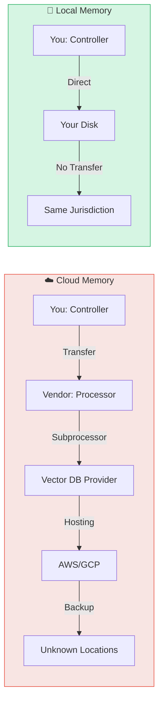

# Data Sovereignty & Compliance

When AI agents process conversations, they handle personal data, proprietary information, and potentially regulated content. **Data sovereignty** determines who controls this data, where it lives, and which laws govern it.

## What is Data Sovereignty?

> "Data sovereignty refers to organizational control over where agent context and memory physically reside, who can access it, and which jurisdiction's laws apply."  
> — [Atlan: Data Sovereignty for AI Agents](https://atlan.com/know/ai-agent/data-sovereignty-for-ai-agents/)

For AI agent memory, this means:

- **Physical location**: Which servers store conversation data
- **Legal jurisdiction**: Which country's laws apply
- **Access control**: Who can read, modify, or delete the data
- **Data residency**: Requirements to keep data within specific borders

---

## Why It Matters

### GDPR & Privacy Laws

The EU's General Data Protection Regulation (GDPR) requires:

1. **Lawful basis** for processing personal data
2. **Data minimization** (collect only what's necessary)
3. **Right to erasure** (users can request deletion)
4. **Right to access** (users can download their data)
5. **Data protection impact assessments** for high-risk processing

**Challenge for cloud memory**:

When conversations flow through a U.S.-based API provider, you're subject to:

- GDPR (if users are in EU)
- CCPA (if users are in California)
- Provider's own data retention policies
- U.S. CLOUD Act (government access to data)

**Compliance burden**: You must track data flows, ensure vendor compliance, and maintain audit logs across multiple systems.

---

### SCHREMS II & Data Transfers

The 2020 *Schrems II* ruling invalidated EU-US Privacy Shield, making transatlantic data transfers legally complex:

- Standard Contractual Clauses (SCCs) are required
- Risk assessments must consider U.S. surveillance laws
- Many organizations now require EU-only data storage

**Real-world impact**: European healthcare and government agencies often ban U.S. cloud services entirely.

---

### Industry-Specific Regulations

| Sector | Regulation | Key Requirement |
|--------|-----------|-----------------|
| **Healthcare** | HIPAA (US), GDPR (EU) | Protected health information must be encrypted and access-logged |
| **Finance** | SOX, PCI-DSS | Audit trails for all data access, retention policies |
| **Defense** | ITAR, CMMC | Air-gapped systems, U.S. persons only |
| **Government** | FedRAMP, StateRAMP | Specific data center certifications required |

**Problem**: Cloud memory providers rarely have all required certifications.

---

## Local-First = Simplified Compliance

### You Are the Data Controller

With Memvault:

- Data never leaves your infrastructure
- No third-party processors to audit
- No cross-border data transfers
- You define retention policies directly



### GDPR Compliance Made Easy

#### Right to Erasure

```sh
# Forget a user completely
memvault forget --user-id abc123

# Preview impact before deleting
memvault forget --user-id abc123 --dry-run
```

Memvault shows exactly which memories and conversations will be deleted — no vendor API calls, no "we'll process your request in 30 days."

#### Right to Access

```sh
# Export all data for a user
memvault export --user-id abc123 --out user-data.zip
```

Includes:

- All conversations (Markdown format)
- Extracted memories
- Evidence links
- SHA-256 checksums for integrity

**Format**: Standard ZIP with human-readable files — users can inspect without proprietary tools.

#### Data Protection Impact Assessment (DPIA)

For local-first systems:

- ✅ Data minimization: You control what's stored
- ✅ Purpose limitation: Code is open, no hidden usage
- ✅ Storage limitation: You set retention policies
- ✅ Security: Encrypted disk, no network exposure

**Compared to cloud**: Vendor's DPIA may not cover your specific use case.

---

## Zero Data Retention Architecture

Some high-security environments require **zero persistent storage** of conversations:

> "Zero data retention architectures process prompts, context windows, and outputs in-memory only and never write to persistent storage."  
> — [NeuralTrust: Zero Data Retention Agents](https://neuraltrust.ai/blog/zero-data-retention-agents)

**Memvault supports this**:

```sh
# In-memory mode (no disk writes)
memvault serve --mode in-memory
```

Use cases:

- Defense contractors (ITAR compliance)
- Healthcare consultation tools (HIPAA "minimum necessary")
- Legal research (attorney-client privilege)

---

## Memory Governance

### Access Control

Memvault supports role-based access:

```yaml
# config.yaml
access_control:
  - role: admin
    can: [read, write, delete, export]
  - role: agent
    can: [read, write]
  - role: auditor
    can: [read, export]
```

**Principle of least privilege**: Agents get only the memory access they need.

### Retention Policies

```yaml
# Auto-delete old conversations
retention:
  conversations:
    max_age_days: 365
  memories:
    max_age_days: 0  # Never delete
```

### Audit Logs

Every memory operation is logged:

```json
{
  "timestamp": "2026-01-15T10:30:00Z",
  "operation": "memory_update",
  "user": "agent-123",
  "memory_id": "abc-def-ghi",
  "change": "updated preference"
}
```

**Compliance benefit**: Prove who accessed what and when.

---

## Multi-Region Deployment

For global organizations:

```
memvault/
├── eu-vault/       # EU citizens' data (GDPR jurisdiction)
├── us-vault/       # US users (CCPA jurisdiction)
└── asia-vault/     # APAC users (local regulations)
```

Each vault stays in its region:

- No cross-border transfers
- Local law compliance
- Sovereign infrastructure

**Sync**: Use encrypted, audited replication if needed (not built into Memvault, but compatible with Syncthing, rsync, etc.)

---

## Comparison: Cloud vs Local Compliance

| Requirement | Cloud Memory | Memvault (Local) |
|-------------|--------------|------------------|
| **GDPR erasure** | Vendor API request, 30-day SLA | Immediate deletion, full control |
| **Data access** | Proprietary export format | Standard Markdown + ZIP |
| **Cross-border transfer** | Complex SCCs, risk assessment | No transfer (data stays local) |
| **Vendor audit** | Depends on vendor transparency | N/A (you control the code) |
| **Retention policy** | Vendor's policy + your config | Your policy only |
| **Air-gapped deployment** | Impossible | Fully supported |

---

## Real-World Examples

### Case Study: European Healthcare Provider

**Requirement**: GDPR compliance + medical data sovereignty.

**Solution**: Memvault deployed on EU-based servers. No data ever sent to U.S. APIs.

**Result**: Passed GDPR audit with zero vendor dependencies to explain.

---

### Case Study: Defense Contractor

**Requirement**: ITAR compliance (U.S. persons only, no foreign access).

**Solution**: Air-gapped Memvault installation + zero data retention mode.

**Result**: Agent memory for classified design conversations without persistent storage.

---

## SuperLocalMemory Research

Academic research supports local-first memory:

> "[SuperLocalMemory](https://arxiv.org/abs/2603.02240) is a local-first memory system for multi-agent AI that operates without cloud dependencies or external LLM inference calls."

**Key findings**:

- Bayesian trust scoring prevents memory poisoning
- Privacy-preserving by design (no data leaves device)
- Resilient to network attacks (no external surface)

---

## Getting Started with Compliant Memory

1. **Install locally**: Follow [Installation Guide](/guide/installation)
2. **Configure retention**: Set policies in `config.yaml`
3. **Enable audit logs**: `memvault config audit.enabled=true`
4. **Document**: Include Memvault in your DPIA

---

## Learn More

- [Why Local-First?](/concepts/why-local-first) — Technical benefits
- [Storage Design](/concepts/storage) — How data is organized
- [MCP Integration](/concepts/mcp) — Agent access patterns

---

## References

- [Atlan: GDPR Compliance for AI Agents](https://atlan.com/know/ai-agent/gdpr-compliance-for-ai-agents/)
- [Atlan: Data Sovereignty for AI Agents](https://atlan.com/know/ai-agent/data-sovereignty-for-ai-agents/)
- [Min.io: Data Sovereignty for AI FAQ](https://www.min.io/learn/data-sovereignty-for-ai-a-practical-faq)
- [Prediction Guard: Sovereign AI Deployment](https://predictionguard.com/blog/sovereign-ai-deployment)
- [MintMCP: Agent Memory Governance](https://www.mintmcp.com/blog/agent-memory-governance)
- [NeuralTrust: Zero Data Retention Agents](https://neuraltrust.ai/blog/zero-data-retention-agents)
- [arXiv: SuperLocalMemory Paper](https://arxiv.org/abs/2603.02240)
