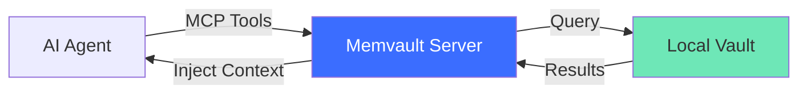

# MCP Integration

Memvault exposes six [Model Context Protocol (MCP)](https://modelcontextprotocol.io/) tools that agents use to read conversations, retrieve memories, and update facts.

## What is MCP?

Model Context Protocol is an open standard for connecting AI agents to data sources. Think of it as "USB for AI" — a unified interface for agents to access external information.



**Benefits**:

- Agents access memory without vendor-specific APIs
- Works across Codex, Claude Code, OpenCode, and any MCP-compatible platform
- Standardized request/response format

---

## Available Tools

### 1. `memvault_context`

Retrieve the full context bundle for the current session: core memories, pending messages, related sessions, and summaries.

**When called**:

- Automatically at conversation start (via hook)
- When agent needs to recall user preferences
- Before making recommendations

**Parameters**:

```json
{
  "agent": "claude",
  "native_id": "session-uuid",
  "query": "optional search term"
}
```

**Returns**:

```json
{
  "core": [
    {
      "id": "abc123",
      "title": "User prefers Go for backend",
      "kind": "preference",
      "body": "User explicitly stated Go is preferred...",
      "evidence": [
        {"session": "xyz", "message": "msg_789"}
      ]
    }
  ],
  "session": {
    "id": "current-session-id",
    "title": "claude · session-uuid",
    "count": 12,
    "missing": 0
  },
  "summaries": [],
  "related": []
}
```

---

### 2. `memvault_memory_update`

Create or update a memory (preference, background, knowledge, or summary).

**When called**:

- User states a new preference
- Agent learns a factual detail
- End of conversation (summary)

**Parameters**:

```json
{
  "id": "optional-for-update",
  "title": "User prefers Go for backend",
  "kind": "preference",
  "body": "User explicitly stated...",
  "evidence": [
    {"session": "xyz", "message": "msg_789"}
  ],
  "parents": ["parent-version-hash"],
  "author": "claude"
}
```

**Returns**:

```json
{
  "id": "abc123",
  "revision": "hash-of-new-version"
}
```

**Evidence tracking**: Every memory must cite source messages. This prevents hallucinated facts.

---

### 3. `memvault_search`

Full-text search across all conversations and memories.

**When called**:

- User asks "What did we discuss about X?"
- Agent needs to find prior context

**Parameters**:

```json
{
  "query": "Go backend",
  "kind": "all",
  "role": "all",
  "sort": "relevance",
  "limit": 20,
  "offset": 0
}
```

**Returns**:

```json
{
  "results": [
    {
      "session": "xyz",
      "message": "msg_789",
      "snippet": "...I prefer <mark>Go</mark> for <mark>backend</mark>...",
      "score": 0.85
    }
  ],
  "total": 1
}
```

**Performance**: <100ms for 1M message corpus (SQLite FTS5).

---

### 4. `memvault_session_read`

Read a specific conversation in full (paginated).

**When called**:

- Agent needs complete context from prior session
- User asks to continue a specific conversation

**Parameters**:

```json
{
  "session": "session-id",
  "limit": 50,
  "offset": 0,
  "message": "optional-start-message-id"
}
```

**Returns**:

```json
{
  "messages": [
    {
      "version": "msg_123",
      "role": "user",
      "text": "Help me write a README",
      "ts": "2026-01-15T10:30:00Z"
    }
  ],
  "total": 120
}
```

---

### 5. `memvault_session_link`

Establish a relationship between sessions (continuation, branch, or reference).

**When called**:

- Conversation explicitly continues a prior one
- User says "Let's pick up where we left off"

**Parameters**:

```json
{
  "from": "new-session-id",
  "to": "prior-session-id",
  "kind": "continuation"
}
```

**Link types**:

- **continuation**: Linear follow-up (same topic, same day)
- **branch**: Alternative approach (forking from prior decision point)
- **reference**: Cited but not directly continued

---

### 6. `memvault_tasks`

Query or claim maintenance tasks (e.g., "summarize session X").

**When called**:

- Agent checks for pending work (auto-invoked periodically)

**Parameters**:

```json
{
  "op": "list",
  "owner": "current-agent"
}
```

**Returns**:

```json
{
  "tasks": [
    {
      "id": "summarize-abc123",
      "kind": "summarize",
      "session": "abc123",
      "pending": 50
    }
  ]
}
```

**Claiming a task**:

```json
{
  "op": "claim",
  "id": "summarize-abc123",
  "owner": "claude"
}
```

After 5 minutes without updates, the claim expires.

---

## Security Model

### Read Access

All tools are **read-only by default** except `memvault_memory_update`.

- Agents can read conversations they participated in
- Cross-session reads require user confirmation (Codex/Claude Code prompt)

### Write Access

- Only `memvault_memory_update` modifies data
- Evidence is mandatory (no unsourced facts)
- Conflicts are detected via version hashes

---

## Error Handling

### Common Errors

| Error | Cause | Fix |
|-------|-------|-----|
| `session_not_found` | Session ID doesn't exist | Verify ID from `memvault_context` |
| `memory_conflict` | Concurrent update | Re-read memory, merge changes, retry |
| `missing_evidence` | No source citations | Add `evidence` array with session + message |
| `invalid_kind` | Unknown memory type | Use: preference, background, knowledge, summary |

### Example: Conflict Resolution

```json
// Agent A and Agent B both update same memory

// Agent A writes first
{"id": "mem1", "parents": ["v1"], "body": "New text A"}
// → Success, new revision "v2"

// Agent B tries to write
{"id": "mem1", "parents": ["v1"], "body": "New text B"}
// → Error: conflict (parent v1 is stale)

// Agent B resolves
1. Read memory (gets version "v2")
2. Merge "New text B" into "v2"
3. Retry: {"id": "mem1", "parents": ["v2"], "body": "Merged text"}
// → Success
```

---

## Usage Patterns

### Pattern 1: Context-Aware Greeting

```typescript
// At conversation start
const ctx = await mcp.call('memvault_context', {
  agent: 'claude',
  native_id: session.id
})

const prefs = ctx.core.filter(m => m.kind === 'preference')
// "I see you prefer Go for backend. Let's use that."
```

---

### Pattern 2: Summarize on Exit

```typescript
// End of conversation
await mcp.call('memvault_memory_update', {
  kind: 'summary',
  session: session.id,
  title: 'README improvement discussion',
  body: `
    Discussed E-E-A-T principles for README.
    Decided to add performance benchmarks and competitor comparison.
    Next: Implement GitHub Pages deployment.
  `,
  evidence: [
    {session: session.id, message: 'msg_456'},
    {session: session.id, message: 'msg_789'}
  ],
  covered: ['msg_123', 'msg_456', 'msg_789']
})
```

---

### Pattern 3: Cross-Session Continuation

```typescript
// User says: "Continue yesterday's discussion"

// 1. Search for recent sessions
const results = await mcp.call('memvault_search', {
  query: 'README discussion',
  sort: 'recent',
  limit: 5
})

// 2. Retrieve full context
const prior = await mcp.call('memvault_session_read', {
  session: results[0].session
})

// 3. Link sessions
await mcp.call('memvault_session_link', {
  from: current_session,
  to: prior.session,
  kind: 'continuation'
})

// 4. Inject context
"Last time we discussed..."
```

---

## MCP Server Configuration

Memvault runs as an MCP server on `http://127.0.0.1:27961/mcp`.

### Codex/Claude Code

Hooks auto-install the MCP configuration. Manual setup:

```json
{
  "mcpServers": {
    "memvault": {
      "url": "http://127.0.0.1:27961/mcp",
      "transport": "sse"
    }
  }
}
```

### Custom MCP Clients

```python
import requests

response = requests.post(
  'http://127.0.0.1:27961/mcp/memvault_context',
  json={
    'agent': 'my-agent',
    'native_id': 'session-123'
  }
)

context = response.json()
```

---

## Learn More

- [MCP Specification](https://modelcontextprotocol.io/)
- [MCP Tool Reference](/reference/mcp-tools) — Complete API docs
- [Agent Memory Guide](/guide/memory) — How to use memory effectively

---

## References

- [Model Context Protocol](https://modelcontextprotocol.io/)
- [MCP GitHub Repository](https://github.com/modelcontextprotocol/specification)
- [Anthropic MCP Quickstart](https://docs.anthropic.com/en/docs/build-with-claude/mcp)
