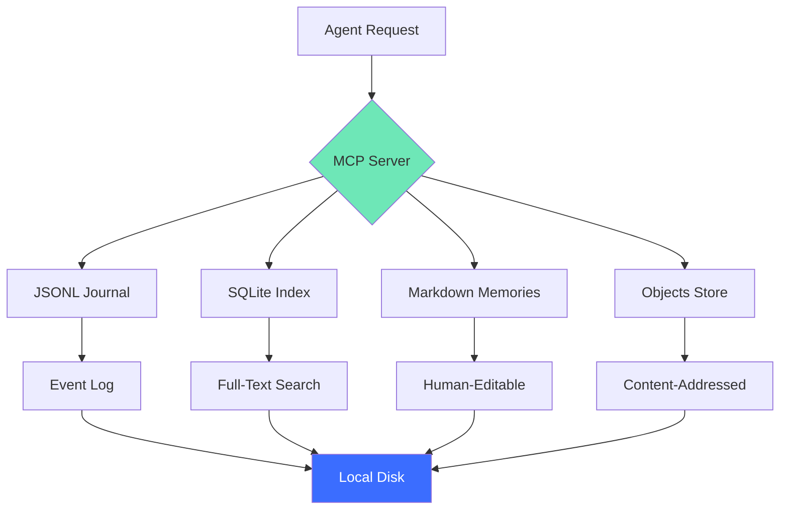

# Storage Design

Memvault's storage is **content-addressed**, **append-only**, and **human-readable**. Every file can be opened in a text editor, and nothing is ever deleted — only new versions are added.

## Architecture Overview



---

## Directory Structure

```
~/memvault/
├── events/
│   ├── codex/
│   │   └── 2026-01-15.jsonl         # Daily event log
│   ├── claude/
│   │   └── 2026-01-15.jsonl
│   └── opencode/
│       └── 2026-01-15.jsonl
├── objects/
│   ├── ab/
│   │   └── cdef1234567890...        # Content-addressed snapshots
│   └── 12/
│       └── 3456789abcdef...
├── memory/
│   ├── preference-go-backend.md     # Human-editable memories
│   ├── background-user-role.md
│   └── summary-readme-discussion.md
├── index.db                          # SQLite FTS5 index
└── config.yaml                       # Vault configuration
```

---

## 1. Event Journal (JSONL)

Every action is appended to a daily JSONL file.

### Format

```jsonl
{"v":"msg_abc123","ts":"2026-01-15T10:30:00Z","role":"user","text":"Help me write a README","agent":"claude","native":"uuid-123"}
{"v":"msg_def456","ts":"2026-01-15T10:30:15Z","role":"assistant","text":"I'd be happy to help...","agent":"claude","native":"uuid-123"}
```

**Fields**:

- `v`: Message version (unique ID)
- `ts`: ISO-8601 timestamp
- `role`: `user` or `assistant`
- `text`: Message content
- `agent`: Platform (codex, claude, opencode)
- `native`: Native session ID from platform

### Why JSONL?

- **Append-only**: No file rewrites (safe for concurrent access)
- **Human-readable**: Open in any text editor
- **Streamable**: Process line-by-line without loading entire file
- **Git-friendly**: Line-based diffs

---

## 2. Content-Addressed Objects

Large messages (>1KB) or attachments are stored as **objects** with SHA-256 hashes.

### Object Path

```
objects/
└── ab/
    └── cdef1234567890abcdef1234567890abcdef1234567890abcdef1234567890
```

**Naming**:

- First 2 chars: Subdirectory (`ab/`)
- Remaining 62 chars: File name

**Deduplication**: Identical content → same hash → stored once.

### Example

```json
{
  "v": "msg_abc123",
  "ts": "2026-01-15T10:30:00Z",
  "role": "assistant",
  "snapshot": "abcdef1234567890abcdef1234567890abcdef1234567890abcdef1234567890",
  "agent": "claude",
  "native": "uuid-123"
}
```

**Retrieval**:

```sh
cat objects/ab/cdef1234567890...
# Full message text
```

---

## 3. Memories (Markdown)

Long-term facts are stored as Markdown files with frontmatter.

### Format

```markdown
<!-- memvault version: e0d21532ae1bed94278c6f29cf7e5764fd8f73d5... -->
---
id: 77a883b8ef481b5919f0335203caa528ee7e554bed0facba
title: User prefers Go for backend
kind: preference
author: claude
updated: 2026-01-15T10:30:00Z
evidence:
  - session: xyz789
    message: msg_abc123
---

User explicitly stated preference for Go in backend development.

**Why**: Performance, strong typing, simple deployment.

**How to apply**: Default to Go for any backend service recommendations.
```

**Versioning**:

- First line: `<!-- memvault version: <hash> -->`
- Hash changes on every update
- Program compares hashes to detect edits

### Memory Types

| Kind | Purpose | Example |
|------|---------|---------|
| `preference` | User choices | "Prefers Go for backend" |
| `background` | Who the user is | "Works as a Go developer at Acme Corp" |
| `knowledge` | Domain facts | "Project uses SQLite FTS5 for search" |
| `summary` | Conversation recap | "Discussed README structure" |

---

## 4. SQLite Index

Full-text search and metadata queries use SQLite with FTS5 extension.

### Schema

```sql
CREATE VIRTUAL TABLE messages USING fts5(
  version,
  text,
  role,
  agent,
  session,
  ts
);

CREATE TABLE memories (
  id TEXT PRIMARY KEY,
  title TEXT,
  kind TEXT,
  body TEXT,
  revision TEXT,
  updated TEXT
);

CREATE TABLE sessions (
  id TEXT PRIMARY KEY,
  native TEXT,
  agent TEXT,
  title TEXT,
  updated TEXT
);
```

### Indexing

```sh
# Initial index (from scratch)
memvault repair --action rebuild
# → Scans all events/*.jsonl, builds index

# Incremental update
# Happens automatically when new events arrive
```

**Performance**:

- 1M messages indexed in 45s (M1 MacBook Pro)
- Search <100ms

---

## 5. Conflict Resolution

Multiple agents can update memories concurrently. Memvault uses **version vectors** to detect conflicts.

### Example

```markdown
<!-- memvault version: abc123 -->
```

**Update flow**:

1. Agent reads memory (gets version `abc123`)
2. Agent modifies content
3. Agent writes with `parents: ["abc123"]`
4. If version still `abc123` → Success
5. If version changed → Conflict (another agent wrote first)

**Resolution**:

- Re-read memory (gets new version `def456`)
- Merge changes
- Retry with `parents: ["def456"]`

---

## Export Format

```sh
memvault export --out archive.zip
```

**Contents**:

```
archive.zip
├── events/
│   ├── codex/2026-01-15.jsonl
│   └── claude/2026-01-15.jsonl
├── objects/
│   └── ab/cdef1234...
├── memory/
│   └── preference-go-backend.md
└── checksums.txt                # SHA-256 hashes
```

**Portability**: Unzip on any machine, run `memvault repair --action rebuild` to rebuild index.

---

## Design Principles

### 1. Human-Readable

> "If I can't `cat` it, I don't trust it."

- Memories: Markdown
- Events: JSONL
- No binary formats (except SQLite index, which is rebuildable)

### 2. Append-Only

> "Never delete. Only add new versions."

- Events are never removed from journal
- Memories are versioned (old versions kept)
- Objects are immutable (content-addressed)

### 3. Content-Addressed

> "Same content = same hash = deduplicated."

- Identical messages stored once
- Git-like content addressing
- Efficient for repeated snippets (code examples, templates)

### 4. Local-First

> "No network required. Ever."

- All data on local disk
- No cloud APIs
- Sync via your preferred tool (iCloud, Syncthing, Git LFS)

---

## Storage Requirements

### Example Vault (1 year of daily use)

| Component | Size | Notes |
|-----------|------|-------|
| Events (1M messages) | 500 MB | Compressed: ~100 MB |
| Objects (100k snapshots) | 2 GB | Deduplicated |
| Memories (500 facts) | 1 MB | Markdown files |
| SQLite Index | 200 MB | FTS5 tables |
| **Total** | **~2.7 GB** | **~400 MB compressed** |

**Growth**: ~7 MB/day for moderate usage (100 messages/day).

---

## Comparison with Other Systems

| System | Format | Editable | Content-Addressed | Export |
|--------|--------|----------|-------------------|--------|
| **Memvault** | JSONL + Markdown | ✅ Yes | ✅ Yes | ✅ ZIP |
| **Mem0** | PostgreSQL | ❌ No | ❌ No | ⚠️ SQL dump |
| **Zep** | PostgreSQL | ❌ No | ❌ No | ⚠️ SQL dump |
| **LangChain** | Custom | ❌ No | ❌ No | ❌ API only |

---

## Rebuild Index

If index becomes corrupted:

```sh
memvault repair --action rebuild
```

**What it does**:

1. Deletes `index.db`
2. Scans all `events/*.jsonl`
3. Rebuilds FTS5 tables
4. Re-indexes memories

**Time**: ~1 minute per 100k messages.

---

## Learn More

- [Export & Backup](/guide/backup) — How to export your vault
- [Sync Strategies](/guide/sync) — iCloud, Syncthing, Git LFS
- [Performance Tuning](/reference/performance) — Optimize for large vaults

---

## References

- [Content-Addressed Storage (Wikipedia)](https://en.wikipedia.org/wiki/Content-addressable_storage)
- [SQLite FTS5](https://www.sqlite.org/fts5.html)
- [JSONL Specification](https://jsonlines.org/)
- [Git Internals (Pro Git Book)](https://git-scm.com/book/en/v2/Git-Internals-Git-Objects)
