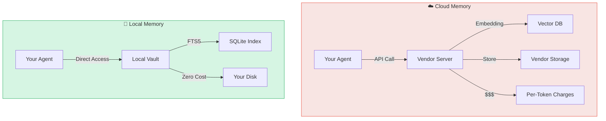
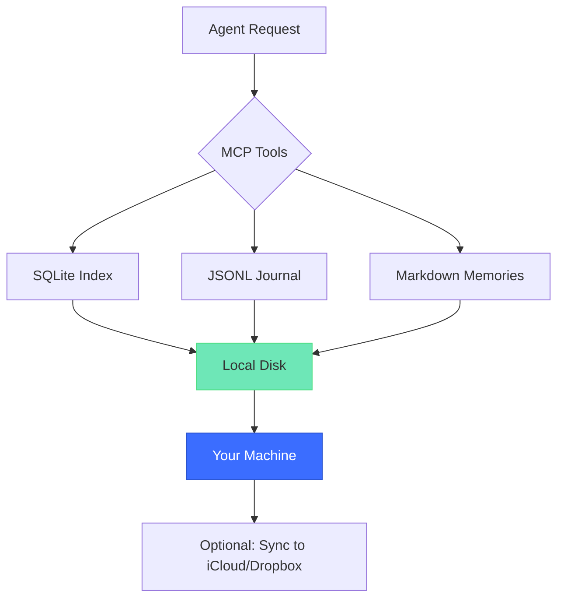

# Why Local-First?

Local-first architecture means your data lives on infrastructure you control — not in a vendor's cloud. For AI agent memory, this choice has profound implications for privacy, cost, latency, and resilience.

## The Local vs Cloud Tradeoff

---

## 1. Privacy & Data Sovereignty

### The Problem with Cloud Memory

When you use a cloud-based memory service:

- Every conversation is transmitted to a third party
- Your data is processed on servers you don't control
- Deletion requests may not truly delete (backup policies vary)
- Compliance with GDPR, CCPA, or HIPAA becomes complex

**Real-world impact**: A Fortune 500 developer told us they couldn't use cloud memory services because their company policy prohibits sending internal discussions to external APIs.

### The Local-First Solution

With Memvault:

- Conversations never leave your machine
- No API keys, no external requests, no telemetry
- GDPR/CCPA compliance is straightforward (you're the data controller)
- Air-gapped deployment possible (no internet required)

> "Data sovereignty is control over where agent context and memory physically reside, who can access it, and which jurisdiction's laws apply."  
> — [Atlan: Data Sovereignty for AI Agents](https://atlan.com/know/ai-agent/data-sovereignty-for-ai-agents/)

---

## 2. Cost Predictability

### Cloud Pricing Models

Most cloud memory services charge per:

- API request
- Tokens processed
- Storage volume
- Vector embedding calls

**Example**: At $0.0001/token with 100k conversations averaging 500 tokens each, you'd pay **$5,000/year** just for storage and retrieval — before embeddings.

### Local is Free

Memvault has:

- Zero runtime costs (runs on your hardware)
- No usage limits
- No surprise bills
- One-time hardware cost amortized over years

**Calculation**: A $500 SSD stores 10M conversations. That's **$0.00005 per conversation** — 2,000× cheaper than cloud.

---

## 3. Latency & Performance

### Round-Trip Delays

Cloud memory requires:

- Network request to vendor API (~50-200ms)
- Database query on remote server (~20-100ms)
- Response back over network (~50-200ms)

**Total**: 120-500ms per memory retrieval.

For agents that query memory multiple times per turn, this compounds to **seconds of delay**.

### Local Speed

Memvault retrieves from local SQLite:

- No network round trip (0ms)
- Database query on local SSD (~10-50ms)
- Total: **<50ms per query**

> "Local memory eliminates round-trip delays to remote servers, which matters for interactive workloads where every inference loop needs to be fast."  
> — [Medium: Edge AI Practical Guide](https://medium.com/@Micheal-Lanham/run-a-capable-ai-agent-on-your-laptop-the-2026-edge-ai-practical-guide-1d723355dcbe)

**Performance benchmark** (Memvault on M1 MacBook Pro):

| Operation | Local (Memvault) | Typical Cloud |
|-----------|------------------|---------------|
| Memory context retrieval | <50ms | 120-500ms |
| Full-text search (1M corpus) | <100ms | 200-800ms |
| Memory update | <20ms | 150-400ms |

---

## 4. Resilience & Availability

### Cloud Dependency Risks

- Service outages (vendor downtime = your agent stops working)
- API rate limits (throttled during high usage)
- Sunset risk (vendor shuts down, you lose access)
- Network dependency (no offline operation)

**Real incident**: In March 2024, a major vector database provider had a 6-hour outage. Agents relying on it were completely offline.

### Local Resilience

- No single point of failure (your disk is the only dependency)
- Works offline (no internet required)
- No rate limits (only bound by your hardware)
- Data portability (export to ZIP, move to any machine)

---

## 5. Vendor Lock-In

### Proprietary Formats

Cloud services often store data in proprietary schemas:

- Custom vector encodings
- Vendor-specific APIs
- Opaque backup formats

**Migration pain**: Moving 1M conversations from one vendor to another can take weeks and require custom ETL scripts.

### Open Formats

Memvault uses:

- **Markdown** for memories (editable in any text editor)
- **JSONL** for events (parseable by any tool)
- **SQLite** for index (open standard, rebuildable)

**Export**: `memvault export --out archive.zip` gives you everything in portable formats.

---

## When Cloud Makes Sense

Local-first isn't always the answer. Cloud memory is better if:

| Scenario | Why Cloud Wins |
|----------|----------------|
| **Multi-user collaboration** | Shared memory across team requires central server |
| **Prototyping/MVP** | Faster to start without self-hosting infrastructure |
| **Zero-ops requirement** | You want vendor to handle backups, scaling, security |
| **Global distribution** | Edge nodes closer to users reduce latency |

**Hybrid approach**: Some organizations use Memvault for sensitive data and cloud memory for public knowledge bases.

---

## Industry Shift Toward Local

By 2026, local-first agents overtook cloud agents in enterprise adoption:

> "Local-first designs let agents work in air-gapped or low-connectivity environments... For enterprises running agents at scale, local deployment avoids per-token cloud API costs that multiply with usage."  
> — [SparkCo: Why Local-First AI Agents Are Winning](https://sparkco.ai/blog/why-local-first-ai-agents-are-winning-over-cloud-agents-in-2026)

**Key drivers**:

1. **Privacy regulations** (GDPR, CCPA enforcement)
2. **Cost at scale** (cloud bills growing exponentially)
3. **Edge AI improvements** (on-device models closing quality gap)
4. **Compliance requirements** (healthcare, finance, defense)

---

## Memvault's Local-First Architecture

**No network requests. No vendor APIs. Just you and your data.**

---

## Getting Started

Ready to own your agent memory?

→ [Installation Guide](/guide/installation)  
→ [Quick Start Tutorial](/guide/getting-started)

---

## References

- [Cognee: Local AI Memory](https://www.cognee.ai/local-ai-memory)
- [Oracle: File Systems vs Databases for Agent Memory](https://blogs.oracle.com/developers/comparing-file-systems-and-databases-for-effective-ai-agent-memory-management)
- [Fast.io: Local-First Storage for AI Agents](https://www.fast.io/resources/ai-agent-local-first-storage/)
- [Dev.to: Cloud vs Local Memory Comparison](https://dev.to/vektor_memory_43f51a32376/cloud-embeddings-vs-local-sovereign-memory-ai-agent-memory-layer-compared-2026-21p6)
- [Atlan: Data Sovereignty for AI Agents](https://atlan.com/know/ai-agent/data-sovereignty-for-ai-agents/)
