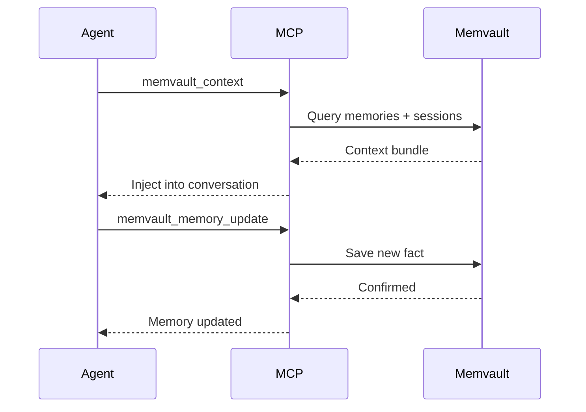

# Getting Started

This guide will have you up and running with Memvault in under 5 minutes.

## Prerequisites

- macOS 11+ or Linux (Windows support coming soon)
- 2GB free disk space
- One of: Codex, Claude Code, or OpenCode installed

## Installation

### macOS (Homebrew)

```sh
brew tap memvault-org/tap
brew install memvault
```

### Linux / Manual Install

Download the latest release for your platform:

```sh
# macOS ARM64
curl -LO https://github.com/memvault-org/memvault/releases/latest/download/memvault_VERSION_darwin_arm64.tar.gz
tar xzf memvault_VERSION_darwin_arm64.tar.gz
sudo mv memvault /usr/local/bin/

# Linux AMD64
curl -LO https://github.com/memvault-org/memvault/releases/latest/download/memvault_VERSION_linux_amd64.tar.gz
tar xzf memvault_VERSION_linux_amd64.tar.gz
sudo mv memvault /usr/local/bin/
```

Verify installation:

```sh
memvault version
# memvault 0.1.0
```

---

## Setup Your Vault

Initialize a memory vault (this is where conversations are stored):

```sh
memvault setup --root ~/memvault
```

**What this does**:

1. Creates vault directory structure
2. Installs hooks for Codex/Claude Code/OpenCode
3. Initializes SQLite index
4. Generates config file

**macOS Permission Prompt**: You'll be asked to grant Accessibility and File System access. This is required for hook installation.

### Folder Picker

On first run, you can choose the vault location via native file picker:

```sh
memvault setup
# Opens macOS folder picker dialog
```

---

## Verify Integrations

Open the web UI:

```sh
memvault open
```

Navigate to **Sources** page. You should see:

| Source | Hook Installed | Hook Invoked | CLI Available |
|--------|---------------|--------------|---------------|
| Codex | ✅ | ⏳ Pending | ✅ |
| Claude Code | ✅ | ⏳ Pending | ✅ |
| OpenCode | ✅ | ⏳ Pending | ❌ |

**"Hook Invoked"** changes to ✅ after your first conversation post-setup.

**Note**: Codex requires you to **trust the hook** on first run. Click "Trust" in the native Codex prompt.

---

## Start Chatting

Open any supported platform and start a conversation:

```
You: "Test archiving"
Assistant: "Hello! How can I help?"
```

**That's it!** Conversations are now archived automatically.

---

## Explore Your Archive

### Web UI

```sh
memvault open
```

Features:

- **Sessions**: Browse all conversations by date/source
- **Search**: Full-text search across all messages
- **Memories**: View extracted facts and preferences
- **Sources**: Check integration status

### CLI Search

```sh
# Search all conversations
memvault search "test archiving"

# Filter by source
memvault search "test" --source codex

# Show specific session
memvault show <session-id>
```

---

## Give Agents Memory

Agents automatically use memory via MCP (Model Context Protocol) tools — no extra configuration needed.

### How It Works



### Example: Agent Remembers Your Preferences

**First conversation**:

```
You: "I prefer Go for backend and React for frontend"
Agent: "Noted! I'll remember that."
```

**Next day** (different conversation):

```
You: "Help me start a web project"
Agent: "Since you prefer Go + React, here's a starter template..."
```

The agent retrieved your preference from memory automatically.

---

## Configuration

### Config File Location

- macOS: `~/Library/Application Support/memvault/config.yaml`
- Linux: `~/.config/memvault/config.yaml`

### Common Settings

```yaml
# Vault location
vault_dir: /Users/you/memvault

# Web UI port
server:
  port: 27961

# Search language
search:
  languages: [en, zh]

# Auto-archive sources
sources:
  codex: enabled
  claude: enabled
  opencode: enabled
```

---

## Multi-Device Sync

Memvault doesn't include built-in sync. Use your preferred tool:

### iCloud Drive

```sh
memvault setup --root ~/Library/Mobile\ Documents/com~apple~CloudDocs/memvault
```

### Syncthing

1. Install [Syncthing](https://syncthing.net/)
2. Share vault folder across devices
3. Each device maintains its own SQLite index (auto-rebuilt from journal)

### Git LFS

```sh
cd ~/memvault
git init
git lfs track "objects/**"
git add .
git commit -m "Initial vault"
git remote add origin <your-repo>
git push
```

**Note**: Journal files are plain JSONL — no LFS needed. Only `objects/` directory uses LFS.

---

## Next Steps

- [Conversation Archiving](/guide/archiving) — How archiving works
- [Full-Text Search](/guide/search) — Advanced search queries
- [Agent Memory](/guide/memory) — Memory maintenance guide

---

## Troubleshooting

### "Hook not invoked" after setup

**Cause**: Haven't started a conversation yet post-setup.

**Fix**: Open Codex/Claude Code and send any message.

---

### Codex "Untrusted hook" warning

**Cause**: Codex requires explicit trust for new hooks.

**Fix**: Click "Trust" in the Codex prompt. This only happens once.

---

### Web UI won't open

**Cause**: Port 27961 already in use.

**Fix**: Change port in config or kill conflicting process:

```sh
lsof -i :27961
kill <PID>
```

---

### Performance issues with large vaults

**Cause**: SQLite index needs optimization.

**Fix**: Rebuild index:

```sh
memvault repair --action rebuild
```

---

## Get Help

- [GitHub Discussions](https://github.com/memvault-org/memvault/discussions)
- [Report Issues](https://github.com/memvault-org/memvault/issues)
- [Contributing Guide](https://github.com/memvault-org/memvault/blob/main/CONTRIBUTING.md)
