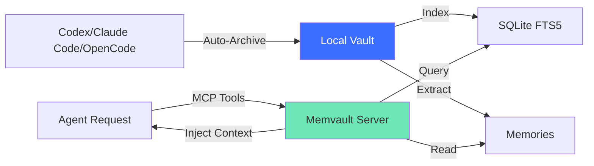
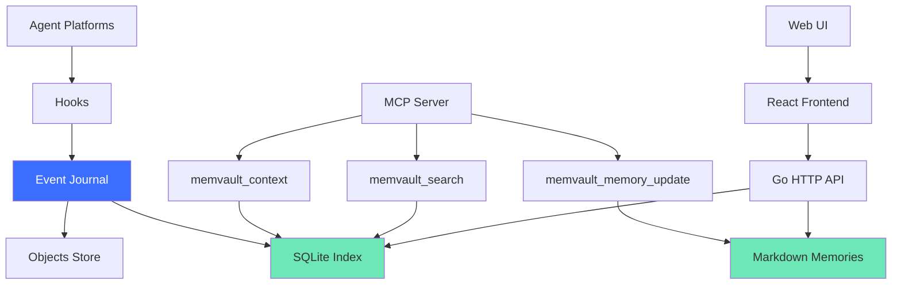

# What is Memvault?

Memvault is a **local-first conversation archive and memory layer** for AI agents. It gives agents long-term memory while keeping your data on infrastructure you control.

## The Problem

AI agents forget everything when a conversation ends:

```
Day 1: "I prefer Go for backend"
Day 2: "What's your coding style?" (agent forgot)
Day 3: "Do you like OOP or FP?" (still doesn't know)
```

Cloud memory services solve this, but introduce new problems:

- Monthly fees + usage limits
- Data leaves your control
- Privacy concerns
- Vendor lock-in

## The Solution

Memvault runs locally:

- ✅ 100% free (no subscription)
- ✅ No usage limits
- ✅ Your data stays local
- ✅ Open formats (export anytime)

```
Day 1: "I prefer Go for backend"
       → Memory: "User prefers Go backend"
Day 2: Agent already knows
Day 3: Agent suggests Go patterns automatically
```

---

## How It Works



**Three components**:

1. **Archive** — Real-time capture from agents
2. **Search** — Full-text search across all conversations
3. **Memory** — Evidence-backed facts for agent context

---

## Key Features

### 1. Automatic Archiving

Conversations from Codex, Claude Code, and OpenCode are saved automatically via hooks.

**No setup required**: Install once, forget about it.

### 2. Blazing Fast Search

Full-text search with Chinese and English support:

```sh
memvault search "Go backend"
```

**Performance**: <100ms for 1M message corpus.

### 3. Agent Memory

Agents access memories via MCP (Model Context Protocol) tools:

- Context injection at conversation start
- Memory updates during conversation
- Cross-session continuation

### 4. Human-Readable Storage

- Memories: Markdown files
- Conversations: JSONL
- Export: Standard ZIP

**No vendor lock-in**: Open any file in a text editor.

### 5. Privacy First

- Zero telemetry
- No cloud APIs
- No external dependencies
- Air-gapped deployment supported

---

## Use Cases

### For Developers

- Remember coding preferences across projects
- Recall past architectural decisions
- Maintain context across debugging sessions

### For Writers

- Track character details across story iterations
- Remember plot decisions
- Build coherent world-building

### For Researchers

- Connect insights across multiple papers
- Build cumulative knowledge base
- Track hypotheses and experiments

### For Teams

- Share agent memory within organization
- Onboard new team members with context
- Maintain institutional knowledge

---

## Comparison

| Feature | Memvault | Cloud Memory Services |
|---------|----------|----------------------|
| **Cost** | Free forever | $10-50/month |
| **Privacy** | 100% local | Data sent to vendor |
| **Speed** | <50ms retrieval | 120-500ms (network) |
| **Limits** | None (disk-bound) | API rate limits |
| **Portability** | Export to ZIP | Vendor-locked |
| **Offline** | ✅ Works offline | ❌ Requires internet |

---

## Who Is This For?

Memvault is for anyone who:

- Uses AI agents regularly
- Values data sovereignty
- Wants agent memory without cloud dependencies
- Needs GDPR/HIPAA-compliant storage
- Runs air-gapped or low-connectivity environments

**Not for you if**:

- You need multi-user collaboration (single-user for now)
- You want zero-ops managed service
- You don't mind sending data to cloud APIs

---

## Architecture



---

## Community & Support

- [GitHub Discussions](https://github.com/memvault-org/memvault/discussions)
- [Report Issues](https://github.com/memvault-org/memvault/issues)
- [Contributing Guide](https://github.com/memvault-org/memvault/blob/main/CONTRIBUTING.md)

---

## License

Memvault is [MIT licensed](https://github.com/memvault-org/memvault/blob/main/LICENSE) — free for personal and commercial use.

---

## Next Steps

→ [Installation](/guide/installation)  
→ [Getting Started](/guide/getting-started)  
→ [Why Local-First?](/concepts/why-local-first)
